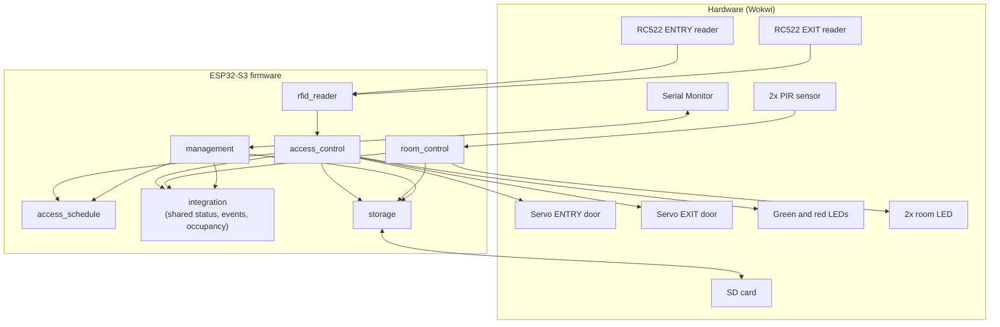
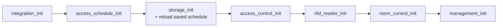
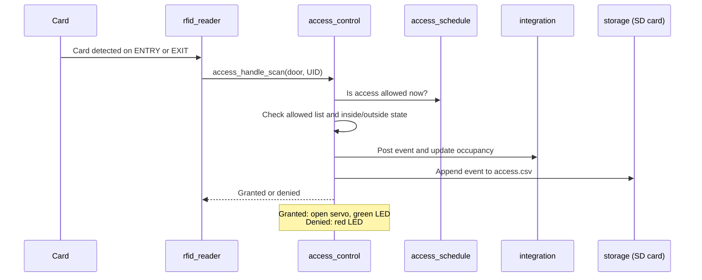
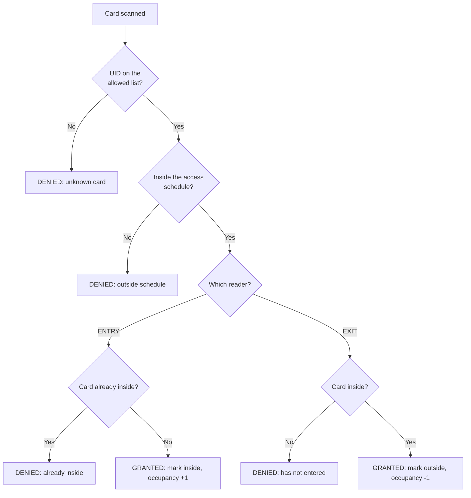

# CoCIS Smart Control and Monitoring System

A Wokwi-simulated smart building system for the College of Computing and Information Sciences (CoCIS), Makerere University. It runs on one **ESP32-S3** and covers three things: RFID access control at the main entrance, motion-based lighting in two lecture rooms, and a serial management console backed by an SD card.

Built with **ESP-IDF 6.0.1** (organised with PlatformIO) and simulated in **Wokwi**.

> Coursework project, BSE III & CS II, academic year 2026/2027.

---

## Table of contents

1. [What it does](#what-it-does)
2. [Architecture](#architecture)
3. [Hardware and pin map](#hardware-and-pin-map)
4. [Project structure](#project-structure)
5. [Setup and running](#setup-and-running)
6. [Using the system](#using-the-system)
7. [How access decisions are made](#how-access-decisions-are-made)
8. [Synchronization](#synchronization)
9. [Changes made to the RC522 library](#changes-made-to-the-rc522-library)
10. [Known limitations](#known-limitations)
11. [Team](#team)

---

## What it does

| Area | Behaviour |
|---|---|
| **Entrance access** | Two RFID readers (ENTRY and EXIT). A card is checked against an allowed list, then the matching door servo opens for 3 seconds. |
| **Entry/exit rules** | A card can enter only when it is outside, and exit only when it is inside. Anything else is denied and logged. |
| **Indicators** | Green LED for granted, red LED for denied. |
| **Occupancy** | The system counts the people currently inside the building. |
| **Access schedule** | An administrator sets the hours when access is allowed. Outside them, both entry and exit are refused, so nobody leaves the building outside the authorised period. |
| **Room automation** | A PIR sensor in each of two lecture rooms switches that room's light on, and off after 20 seconds without motion. |
| **Storage** | Access events, system events, the schedule, admin credentials and light usage are saved on an SD card. |
| **Management console** | A serial menu to view occupancy, room status, access records and light usage, and to configure the schedule after logging in. |

---

## Architecture

The whole system is one firmware image. Each feature is an ESP-IDF **component**, and the components share data only through the `integration` component.



### Startup order

`main.c` starts the components in this order. The order matters, because later components call earlier ones.



### What happens on a card scan



---

## Hardware and pin map

Board: **ESP32-S3 DevKitC-1**. The wiring is defined in `diagram.json`.

| Part | Pin(s) |
|---|---|
| RC522 ENTRY reader | CS 5, RST 4 |
| RC522 EXIT reader | CS 6, RST 7 |
| RC522 shared SPI bus (SPI2) | MOSI 11, SCK 12, MISO 13 |
| Entry door servo | GPIO 14 |
| Exit door servo | GPIO 19 |
| Green LED (granted) | GPIO 48 |
| Red LED (denied) | GPIO 10 |
| SD card (SPI3) | CS 8, SCK 9, MOSI 17, MISO 18 |
| PIR, Room 1 | GPIO 15 |
| PIR, Room 2 | GPIO 16 |
| Room 1 light (red LED) | GPIO 1 |
| Room 2 light (blue LED) | GPIO 2 |

The two RFID readers share one SPI bus and each has its own chip-select pin. The SD card has its own bus.

---

## Project structure

```
.
├── CMakeLists.txt
├── platformio.ini
├── diagram.json            Wokwi circuit
├── wokwi.toml              Wokwi firmware settings
├── main/
│   ├── main.c              Starts every component
│   └── CMakeLists.txt
└── components/
    ├── rc522/              RFID driver (abobija/rc522 4.0.1, patched, see below)
    ├── rfid_reader/        Starts both readers and reports scans
    ├── access_control/     Authorisation, door servos, LEDs
    ├── access_schedule/    Allowed hours and simulated clock
    ├── integration/        Shared data between all components
    ├── room_control/       PIR sensors and room lighting
    ├── storage/            SD card files, admin PIN and ID
    └── management/         Serial menu
```

---

## Setup and running

### Requirements

- VS Code with the **PlatformIO** extension (ESP-IDF framework)
- VS Code with the **Wokwi for VS Code** extension, and a free Wokwi licence

### Steps

1. Clone the repository:
   ```bash
   git clone https://github.com/ezrabenmukisa/smart.git
   cd smart
   ```
2. Build the firmware:
   ```bash
   pio run
   ```
   The first build downloads the toolchain and can take several minutes.
3. Open the folder in VS Code, press `F1`, and choose **Wokwi: Start Simulator**. Wokwi loads the firmware named in `wokwi.toml` (`firmware.bin` in the PlatformIO build folder).
4. Open the Wokwi serial terminal. You should see `SD card mounted`, both readers ready, and the menu.

> Wokwi does not compile code. It runs the firmware that `pio run` produced, so rebuild after every code change.

---

## Using the system

### Cards

| Card | UID | Access |
|---|---|---|
| Blue | `01 02 03 04` | Allowed |
| Green | `11 22 33 44` | Allowed |
| Yellow | `55 66 77 88` | Allowed |
| Red | `AA BB CC DD` | Allowed |
| Any other card (key fob, NFC tag) | - | Denied as unknown |

In Wokwi, click an RC522 reader, pick a card, and use **Tap**. Use the **Hold** switch to keep it in place. Scan on the ENTRY reader to go in and on the EXIT reader to go out.

### Motion sensors

Click a PIR sensor and choose **Simulate motion**.

| Sensor | Room | Light |
|---|---|---|
| `pir2` | Room 1 | red LED |
| `pir1` | Room 2 | blue LED |

The light switches off after 20 seconds without motion.

### Management menu

Type the number in the Wokwi serial terminal and press Enter.

| # | Option | Login needed |
|---|---|---|
| 1 | View building occupancy | No |
| 2 | View room status and lights | No |
| 3 | Manage access schedule | Yes |
| 4 | View recent access records | No |
| 5 | View estimated light usage | No |
| 6 | View persisted event history (SD card) | No |
| 7 | Administrator login | - |
| 8 | View schedule and clock | No |
| 9 | Administrator logout | - |
| 10 | Change administrator PIN | Yes |
| 11 | Set simulated time | Yes |
| 12 | Change administrator ID | Yes |

**Default login:** ID `admin`, PIN `2468`. Change it with option 10. The PIN is stored on the SD card as a salted PBKDF2 hash.

### A short test run

1. Option **11**: log in, then set the time to `09:00`.
2. Option **3**: set the schedule to `08:00` to `17:00`.
3. Scan **Blue on EXIT**: denied (has not entered).
4. Scan **Blue on ENTRY**: granted, entry servo opens, green LED on.
5. Scan **Blue on ENTRY** again: denied (already inside).
6. Option **1**: occupancy is `1`.
7. Scan **Blue on EXIT**: granted. Option **1**: occupancy is `0`.
8. Option **11**: set the time to `20:00`. Scan any allowed card: denied (outside schedule).
9. Trigger a PIR: the room light switches on, then off after 20 seconds. Check option **2**.
10. Options **4** and **6**: every scan appears, with its time, door, result and UID.

---

## How access decisions are made



Every scan, granted or denied, is recorded in the shared event log and appended to `access.csv` on the SD card.

---

## Synchronization

Several tasks run at once: two reader tasks, the room task, the storage task, the management menu and timers. Shared data is protected like this.

| Shared data | Protected by |
|---|---|
| Card inside/outside flags | Mutex in `access_control` |
| Room status | Mutex in `integration` |
| Access event log, event numbers, people-inside count | Mutex in `integration` |
| Schedule and simulated clock | Mutex in `access_schedule` |
| Every SD card file operation | Mutex in `storage` |
| Room state and light timers | Mutex and queue in `room_control` |
| PIR interrupts | Interrupt-safe queue into `light_task` |

Door closing is done by one-shot timers, so a card scan never blocks for the 3 seconds the door stays open.

---

## Changes made to the RC522 library

`components/rc522` is a modified copy of [abobija/rc522](https://components.espressif.com/components/abobija/rc522) 4.0.1. It is kept in the project, and not downloaded, so these two edits are not overwritten. Both were needed to make the library work with Wokwi's simulated RC522. They have only been tested in Wokwi.

**1. FIFO read** (`src/driver/rc522_spi.c`, `rc522_spi_receive`)

The library read the RC522 FIFO one byte per SPI transaction. The simulated chip dropped the second byte (the library's self-test wrote `13 33 37` and read back `13 37 00`). The loop is replaced by one transaction that reads all the bytes (`.rxlength = 8 * bytes->length`).

**2. CRC "done" flag** (`src/rc522_pcd.c`, `rc522_pcd_calculate_crc`)

The simulated chip calculates the correct CRC but never sets the CRC-ready flag the library waits for, so the library timed out before selecting a card. After the 90 ms wait, if the chip's command register has returned to idle, the result is accepted.

**Why a real board is different:** a real RC522 sets that flag within microseconds, so the fallback in change 2 is never reached. Change 1 has not been checked on a real chip.

---

## Known limitations

- The **simulated clock restarts at 00:00 at every boot**. After a restart, set the time with menu option 11. The saved schedule itself is reloaded from the SD card.
- **Card inside/outside states and the occupancy count reset to zero on restart.** The SD card keeps the full event history.
- The shared event log holds the **last 16 events** in memory. The SD card holds everything.
- The schedule applies to **both** doors, so a person inside the building cannot leave outside the allowed hours. This follows the coursework brief.
- The default administrator PIN `2468` is in the source code. Change it after first login.
- Only 4-byte UIDs are on the allowed list.
- The RC522 library edits were tested in Wokwi only, not on a real RC522 module.

---

## Team

| Member | Responsibility |
|---|---|
| Mukisa B. | Main entrance and access control: RFID readers, authorisation, door servos, indicators, entry/exit records |
| Kristiana B. | Lecture room automation: PIR sensors, room lighting, room status |
| Abigaba S. | System integration: shared data and communication between components |
| Gihozo P. | Management menu, schedule, authentication and SD card storage |
